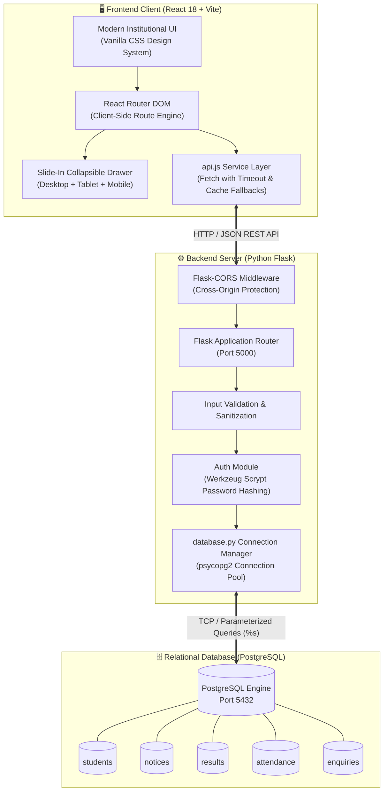
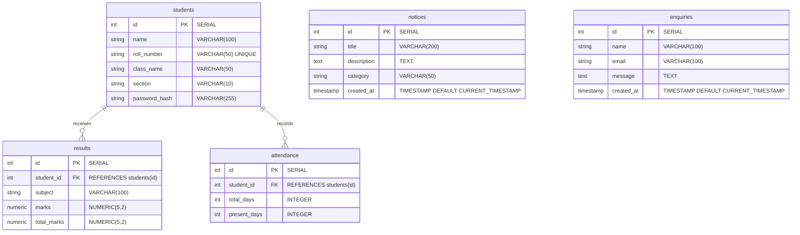
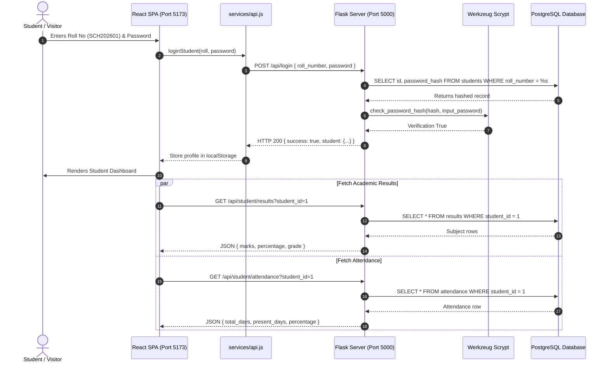

<div align="center">

# 🏛️ SchoolHub — Academic Portal & Student Management System

[](https://reactjs.org/)
[](https://flask.palletsprojects.com/)
[](https://www.postgresql.org/)
[](#-design-system--the-heritage-edit)
[](https://github.com/AyushSrivastava1818/school-portal-)

**A modern, full-stack school web portal and student academic management system designed for educational institutions.**  
*Combines an editorial public campus website with an authenticated student dashboard.*

---

</div>

## 📌 Table of Contents
- [System Architecture](#-system-architecture)
- [Database Schema (Entity Relationship Diagram)](#-database-schema)
- [Data Flow & Request Lifecycle](#-data-flow--request-lifecycle)
- [Key Features & Modules](#-key-features--modules)
- [Design System — "The Heritage Edit"](#-design-system--the-heritage-edit)
- [Technology Stack](#-technology-stack)
- [Project Directory Structure](#-project-directory-structure)
- [Installation & Quick Start](#-installation--quick-start)
- [REST API Reference](#-rest-api-reference)
- [Group Member Contributions](#-group-member-contributions)

---

## 🏗️ System Architecture

The project employs a decoupled client-server architecture. The React single-page application interacts with the Flask backend exclusively over a secure RESTful JSON API layer.



---

## 🗃️ Database Schema

All relational entities adhere to 3NF normal form with explicit foreign keys and `ON DELETE CASCADE` referential constraints.



---

## 🔄 Data Flow & Request Lifecycle

This sequence diagram illustrates how a student authenticates, accesses attendance metrics, and loads circulars from PostgreSQL.



---

## 🌟 Key Features & Modules

### 1. Public Institutional Portal
- **Collapsible Navigation Drawer**: Accessible on all screen sizes with smooth slide animation, backdrop blur overlay, and keyboard accessibility (`Escape` key close).
- **Home Page**: Hero showcase, Principal’s welcome letter, key educational pillars, academic highlights, campus facilities, dynamic announcements, and upcoming events calendar.
- **About Us**: Institution profile (established 1948), CBSE accreditation, Vision, Mission, and historical timeline from founding to present.
- **Academics**: Interactive stream switcher (**Science / PCM-PCB**, **Commerce & Finance**, **Humanities & Liberal Arts**) with detailed subject lists and career trajectories.
- **Facilities Showcase**: Photo cards with feature tags highlighting the Great Library, modern Science Laboratories, Turing Computer Center, Sports Grounds, and Smart Classrooms.
- **Live Notice Board**: Real-time announcements fetched from PostgreSQL with category pills (*Academic, Event, Sports, General*) and dynamic keyword search filtering.
- **Contact & Admissions**: Campus visiting hours, telephone helpline, embedded interactive map, and a functional admission enquiry form that writes to the database.

### 2. Authenticated Student Portal
- **Secure Authentication**: Roll Number and Password verification using cryptographic Scrypt hashes.
- **Student Profile**: Roll Number, Class, Section, and Academic Session.
- **Attendance Tracker**: Visual progress bar, percentage indicator, working/present/absent day count, and board exam eligibility status.
- **Subject-Wise Results Table**: Subject descriptions, marks scored, maximum marks, individual subject performance badges, and cumulative term grade.
- **One-Click Demo Evaluator**: Preset login quick-fill buttons for test evaluation and presentations.

---

## 🎨 Design System — "The Heritage Edit"

| Color Tone | Hex Code | Purpose |
|:---|:---|:---|
| **Warm Ivory** | `#F8F5EE` | Primary page background; eliminates visual eye strain |
| **Deep Burgundy** | `#713B37` | Primary action buttons, badges, and key accents |
| **Forest Green** | `#35483A` | Contrasting institutional sections and banner highlights |
| **Antique Gold** | `#B68A50` | Crest accents, card borders, and sub-headings |
| **Charcoal** | `#2A2824` | High-contrast editorial typography and footer background |

- **Typography**: Google Fonts pairing — **Playfair Display** (Headings) + **Inter** (Body text & navigation).

---

## 💻 Technology Stack

```
Frontend:
  ├── React 18
  ├── Vite (Lightning build & HMR)
  ├── React Router DOM v7
  ├── Lucide React (Clean feather icons)
  └── Vanilla CSS (Modern CSS Custom Properties)

Backend:
  ├── Python 3.9+
  ├── Flask 3.x (WSGI Micro-framework)
  ├── Flask-CORS (Cross-Origin Policy Middleware)
  ├── psycopg2-binary (PostgreSQL Driver)
  ├── python-dotenv (Environment config)
  └── Werkzeug Security (Scrypt password hashing)

Database:
  └── PostgreSQL 14+ (Relational SQL Engine)
```

---

## 📁 Project Directory Structure

```
school-portal/
├── backend/
│   ├── app.py              # Main Flask REST API application
│   ├── database.py         # PostgreSQL connection manager & DDL executor
│   ├── init_db.py          # Database setup and seed utility script
│   ├── schema.sql          # Relational SQL table definitions
│   ├── seed.sql            # Starter institutional seed data & scrypt hashes
│   ├── requirements.txt    # Python dependencies
│   ├── .env                # Local database configuration
│   └── .env.example        # Configuration template
│
├── frontend/
│   ├── public/
│   │   ├── logo.svg        # Custom heritage collegiate seal
│   │   └── favicon.svg
│   ├── src/
│   │   ├── components/
│   │   │   ├── Navbar.jsx          # Always-accessible navigation & slide-in drawer
│   │   │   ├── Footer.jsx          # Institutional footer & campus contacts
│   │   │   ├── NoticeCard.jsx      # Modular announcement card with category badges
│   │   │   └── FacilityCard.jsx    # Photo showcase card with hover transitions
│   │   ├── pages/
│   │   │   ├── Home.jsx            # Editorial homepage
│   │   │   ├── About.jsx           # Vision, history timeline & achievements
│   │   │   ├── Academics.jsx       # Stream tab switcher & teaching methodology
│   │   │   ├── Facilities.jsx      # Campus infrastructure showcase
│   │   │   ├── Notices.jsx         # Live circulars with search & category filters
│   │   │   ├── Contact.jsx         # Contact info & functional enquiry form
│   │   │   ├── StudentLogin.jsx    # Student authentication with demo autofill
│   │   │   └── StudentDashboard.jsx# Attendance meter & subject marks breakdown
│   │   ├── services/
│   │   │   └── api.js              # Centralized fetch API methods with fallbacks
│   │   ├── App.jsx                 # Routing configuration
│   │   ├── index.css               # Heritage design system styles
│   │   └── main.jsx                # React DOM entrypoint
│   ├── package.json
│   └── vite.config.js
│
├── .gitignore
└── README.md
```

---

## 🚀 Installation & Quick Start

### 1. Prerequisites
- **Node.js** (v18+) & **npm**
- **Python** (v3.9+)
- **PostgreSQL** running locally on port `5432`

### 2. Database Setup
```bash
cd backend

# Initialize database, create tables, and populate sample records
python init_db.py
```

### 3. Start Flask Backend
```bash
cd backend
python app.py
```
*API server starts at `http://localhost:5000`.*

### 4. Start React Frontend
In a separate terminal window:
```bash
cd frontend
npm install
npm run dev
```
*Frontend starts at `http://localhost:5173`.*

---

## 📡 REST API Reference

| Method | Endpoint | Description | Query / Payload |
|---|---|---|---|
| `GET` | `/api/health` | Diagnostics & DB health check | None |
| `GET` | `/api/notices` | All notices with optional filtering | `?category=Academic` |
| `GET` | `/api/notices/latest` | Latest 4 notices for the homepage | None |
| `POST` | `/api/contact` | Submits enquiry into `enquiries` table | `{"name":"...","email":"...","message":"..."}` |
| `POST` | `/api/login` | Authenticates student roll number & password | `{"roll_number":"...","password":"..."}` |
| `GET` | `/api/student/profile` | Student profile info | `?student_id=1` |
| `GET` | `/api/student/results` | Subject marks, percentage & grades | `?student_id=1` |
| `GET` | `/api/student/attendance` | Attendance statistics & exam eligibility | `?student_id=1` |

### Sample Login Credentials
| Student Name | Roll Number | Password | Attendance | Marks Aggregate |
|:---|:---|:---|:---|:---|
| **Alexander Vance** | `SCH202601` | `password123` | **93.3%** (168/180 days) | **92.67%** (A+ Distinction) |
| **Sophia Montgomery** | `SCH202602` | `password123` | **96.7%** (174/180 days) | **95.67%** (A+ Distinction) |
| **Ethan Hawthorne** | `SCH202603` | `password123` | **88.3%** (159/180 days) | **87.25%** (A Excellent) |

---

## 👥 Group Member Contributions

| Member | Module & Responsibilities | Key Deliverables |
|:---|:---|:---|
| **Student 1** | **Frontend Lead & Homepage** | Heritage design system, `Navbar.jsx` with slide-in drawer, `Home.jsx`, and branding |
| **Student 2** | **Informational Pages** | `About.jsx` (Timeline & Vision), `Academics.jsx` (Stream selector), `Facilities.jsx`, `Footer.jsx` |
| **Student 3** | **Flask Backend API** | REST API endpoints (`app.py`), Werkzeug password hashing, CORS, and input validation |
| **Student 4** | **Database Architecture** | PostgreSQL DDL (`schema.sql`), sample `seed.sql`, and database connection logic |
| **Student 5** | **Student Portal & Integration** | `StudentLogin.jsx`, `StudentDashboard.jsx`, API fetch service (`api.js`), and test suite |
